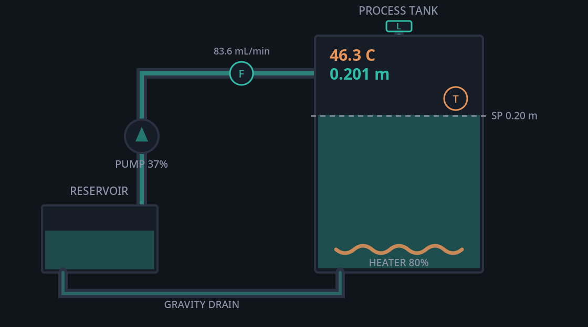
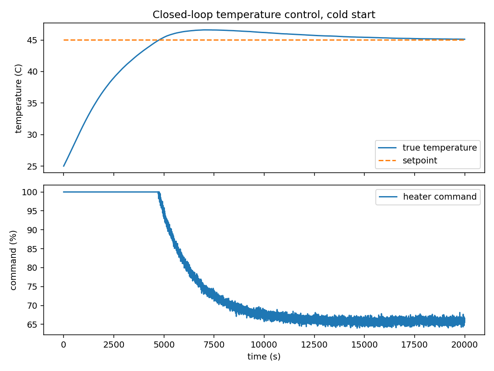
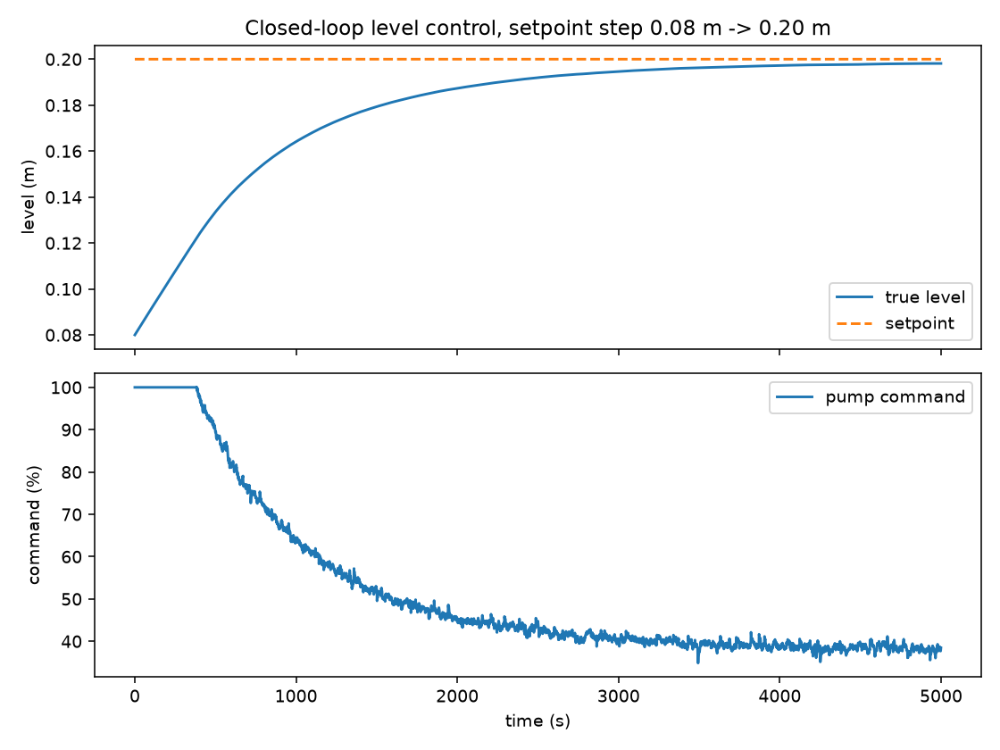
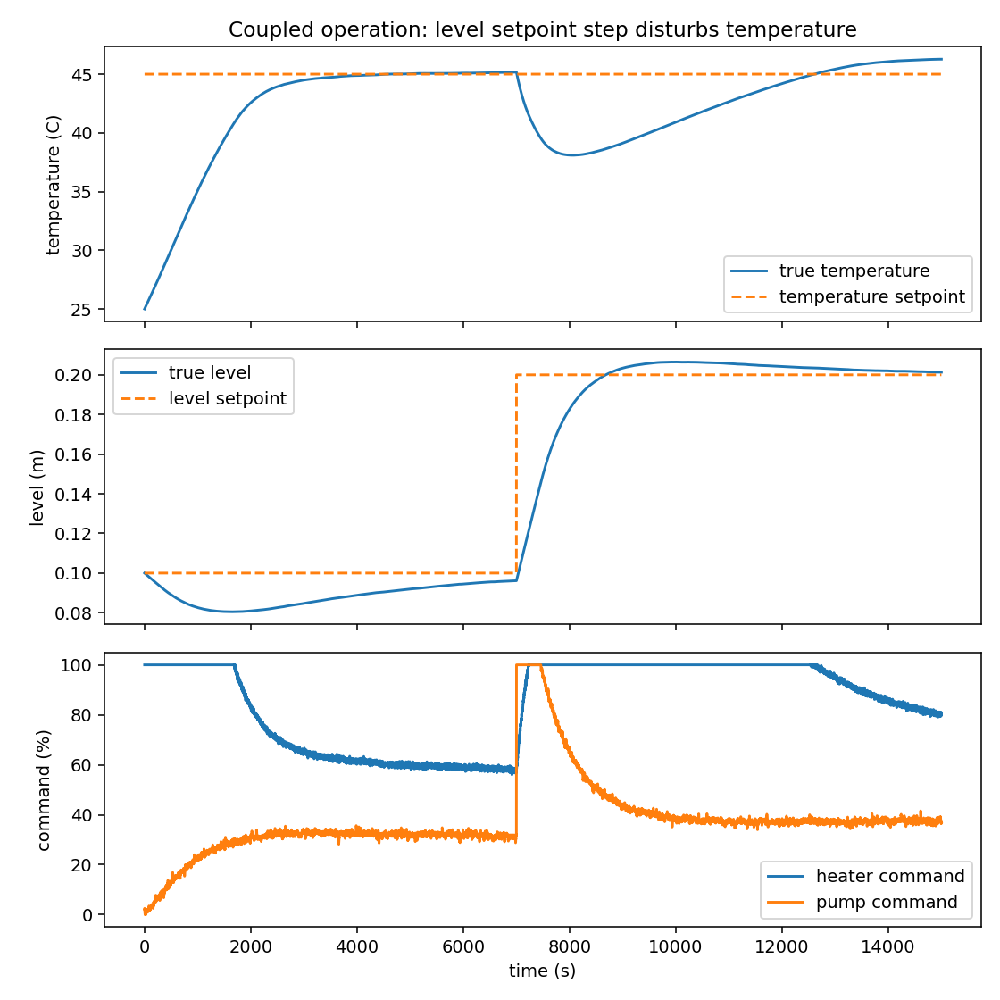
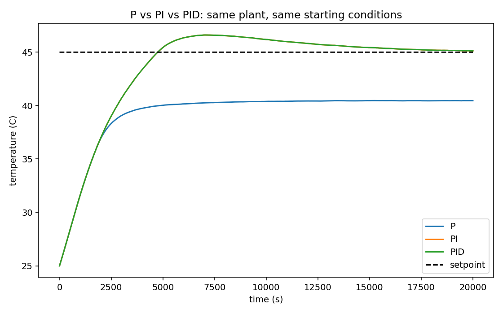
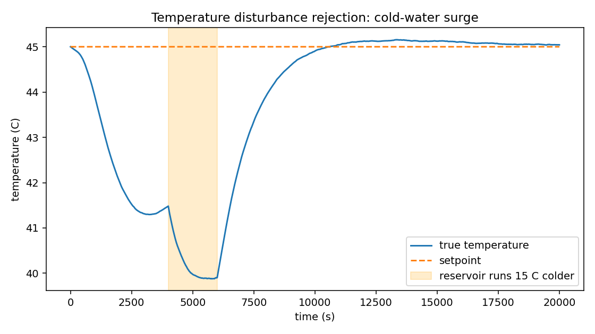
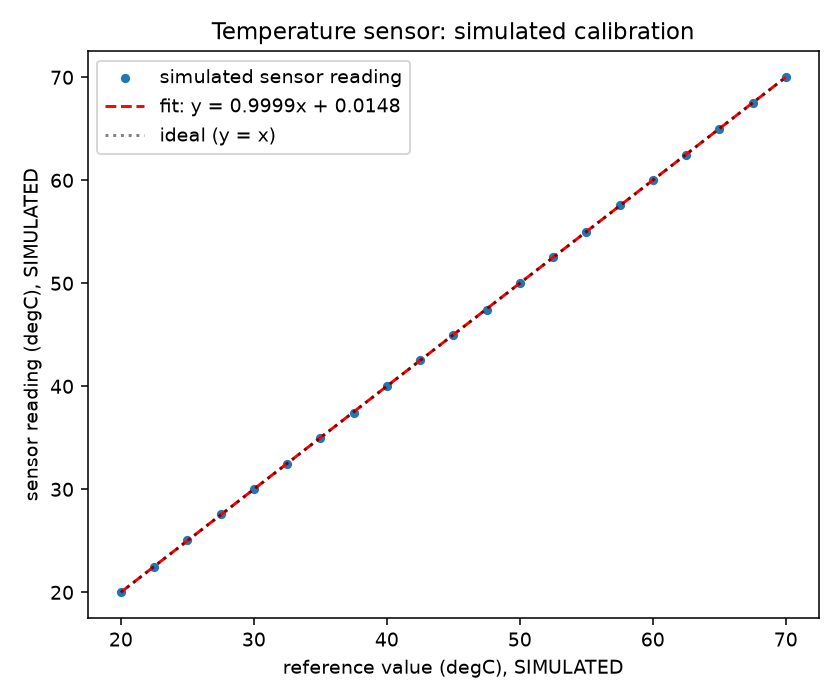

# Aqualoop

**Virtual multi-loop process control and instrumentation system**

Aqualoop is a Python simulation of a small process tank with two interacting feedback loops: PI control of liquid level and PID control of water temperature. The project combines a dynamic plant model, virtual sensors, calibration and filtering, controller tuning, fault injection, experiment scripts, and a Streamlit dashboard for exploring the system.

This is a software simulation. The tank, pump, heater, and sensors are modeled in code; the results are not measurements from a physical apparatus.



*Process schematic rendered by the same SVG component used in the dashboard. The displayed operating point is taken from a generated coupled-system simulation.*

## What the project includes

- **Coupled plant model:** tank level follows an inlet and gravity-drain mass balance. Temperature follows a variable-mass energy balance, so changing inlet flow also affects the thermal response.
- **Feedback control:** a discrete PI controller regulates level and a discrete PID controller regulates temperature. Both have output limits and anti-windup behavior.
- **Virtual instrumentation:** temperature, level, and flow sensors model configurable noise, resolution, delay, bias, and selected failure modes.
- **Calibration and filtering:** generated calibration readings are fitted with a linear model, and measured signals can be filtered before they reach the controllers.
- **Disturbances and faults:** the simulation can change process conditions or introduce sensor and actuator problems while the closed loop is running.
- **Experiment runner:** eleven experiments cover calibration, open-loop identification, closed-loop response, disturbances, coupling, and controller comparison. CSV data, figures, and JSON summaries are generated where applicable.
- **Interactive dashboard:** six Streamlit views cover process overview, control, instrumentation, experiments, faults and disturbances, and results analysis.

## Selected results

The experiment runner was executed against the included source code. The figures below were copied from the newly generated outputs. All values are simulated.

### Closed-loop temperature control



Experiment 05 starts at 25 °C and tracks a 45 °C temperature setpoint while the level loop operates at its configured setpoint. The response is intentionally slow because the model represents a small tank heated by a 180 W heater while cooler reservoir water continues to enter the tank.

### Closed-loop level control



Experiment 08 shows the level PI loop moving the simulated tank toward its target. The reported final steady-state error is approximately 1.88 mm under this experiment's conditions.

### Coupling between level and temperature



In Experiment 10, the level setpoint changes from 0.10 m to 0.20 m at 7,000 simulated seconds. The higher pump flow required to raise the level brings more reservoir-temperature water into the tank. This interaction causes a temperature dip even though the temperature setpoint remains at 45 °C.

### Controller comparison



Experiment 11 compares P, PI, and PID temperature control under the same simulated conditions. P-only control retains a steady-state offset. PI and PID remove most of that offset, and their responses are very similar for this plant model.

### Disturbance rejection



Experiment 07 applies a 15 °C drop in inlet-water temperature. The control loop recovers after the simulated thermal disturbance.

### Instrument calibration



Calibration plots are generated from simulated sensor readings, not from a physical calibration bench. Similar plots are generated for level and flow sensors.

## Results at a glance

These values come from the JSON reports regenerated by `python -m src.experiments.runner`.

| Experiment | Conditions | Simulated result |
| --- | --- | --- |
| 05: Closed-loop temperature | 25 °C initial temperature, 45 °C target | 3,536 s rise time, 8.04% overshoot, 11,559 s settling time, 0.129 °C steady-state error |
| 07: Temperature disturbance | Inlet-water temperature step of -15 °C | 5.12 °C maximum temperature dip, 2,220 s recovery time |
| 08: Closed-loop level | Level setpoint step | 1,952 s rise time, 0% overshoot, 3,369 s settling time, 0.00188 m steady-state error |
| 09: Level disturbance | Additional outflow of 2.5e-6 m³/s | 0.0457 m maximum level dip, 3,356 s recovery time |
| 10: Coupled operation | Level target changes from 0.10 m to 0.20 m | 7.05 °C temperature dip due to the level-loop change |
| 11: Controller comparison | P, PI, and PID on the same simulated plant | P retains about 4.54 °C steady-state error; PI and PID finish close to the target |

Times in this table are simulated seconds, not wall-clock runtime. Metrics depend on the configured model and the conditions of each experiment. They should not be interpreted as measured performance of physical equipment.

## Process model

### Liquid level

The tank level model uses a mass balance and a gravity-drain relationship:

\[
A\frac{dh}{dt}=Q_{\mathrm{in}}-Q_{\mathrm{out}}
\]

\[
Q_{\mathrm{out}}=C_d A_o\sqrt{2gh}
\]

Here, \(A\) is the tank cross-sectional area, \(h\) is liquid height, \(Q_{\mathrm{in}}\) is pump inflow, \(Q_{\mathrm{out}}\) is drain flow, \(C_d\) is the discharge coefficient, \(A_o\) is the drain opening area, and \(g\) is gravitational acceleration. The pump command is mapped to flow using a nonlinear curve with a low-command dead zone rather than assuming a linear command-to-flow relationship.

### Water temperature

The thermal model treats the tank as a well-mixed volume whose water mass changes with the level:

\[
mc_p\frac{dT}{dt}=\rho Q_{\mathrm{in}}c_p(T_{\mathrm{in}}-T)+Q_{\mathrm{heater}}-Q_{\mathrm{loss}}
\]

Here, \(m\) is the water mass, \(c_p\) is specific heat capacity, \(T\) is tank temperature, \(T_{\mathrm{in}}\) is inlet-water temperature, \(\rho\) is water density, \(Q_{\mathrm{heater}}\) is heater power, and \(Q_{\mathrm{loss}}\) is the modeled heat loss to ambient air.

The inflow term links the loops. When the level controller increases pump flow, more reservoir-temperature water enters the tank and changes the heating load. A low-level interlock also prevents the simulated heater from operating below its configured safe level.

The plant equations and parameter assumptions are implemented in `src/plant/` and `src/simulation/configuration.py`. The state is advanced using an explicit Euler step with a default simulation timestep of 1 second.

## Control and instrumentation

### Controllers

- **Level PI:** adjusts pump command to reduce the difference between target and measured liquid level.
- **Temperature PID:** adjusts heater command to track the temperature target. The derivative term acts on the measurement and uses a low-pass filter.
- **Output limits and anti-windup:** actuator commands are kept within configured bounds, and the integral action is managed to limit windup at the bounds.
- **Model-based tuning:** `src/control/tuning.py` identifies a first-order-plus-dead-time approximation from an open-loop step response and applies a SIMC tuning rule. Identified models and selected gains are recorded in the experiment report and configuration comments.

### Virtual sensors

The temperature, level, and flow sensor models provide simulated measurements with configurable imperfections. Depending on the sensor and selected mode, these can include noise, finite resolution, response delay, bias, missed readings, and stuck values. The instrumentation code also provides calibration and filtering behavior.

### Disturbances and faults

The disturbance framework changes the process, for example by stepping ambient or reservoir temperature or adding extra drain flow. The fault framework can introduce sensor bias, noise, dropout, stuck readings, reduced pump or heater effectiveness, or additional heat loss. These conditions affect the live simulation state rather than being added to a plot after the run.

## Experiments

Run all experiments with:

```bash
python -m src.experiments.runner
```

The current runner executes these eleven experiments:

1. Temperature sensor calibration.
2. Level sensor calibration.
3. Flow sensor calibration.
4. Open-loop temperature step response and model identification.
5. Closed-loop temperature control.
6. Controller tuning report for the temperature and level loops.
7. Temperature disturbance rejection.
8. Closed-loop level control.
9. Level disturbance rejection.
10. Coupled level and temperature operation.
11. P versus PI versus PID comparison.

Generated CSV files are written to `data/generated/`, plots to `results/figures/`, and JSON summaries to `results/reports/`. Curated copies of selected plots for the README are stored in `docs/images/` so their image paths can be committed with the documentation.

## Dashboard

The Streamlit dashboard is launched with:

```bash
streamlit run app/dashboard.py
```

It has six views:

| View | Purpose |
| --- | --- |
| Process Overview | Set temperature and level targets, run a simulation, inspect the process schematic, and scrub through the run. |
| Control Engineering | Review controller gains, tuning rationale, and control errors. |
| Instrumentation | Inspect sensor settings, raw and filtered signals, and simulated calibration. |
| Experiments | Select and run one of the implemented experiments. |
| Fault & Disturbance Testing | Configure disturbances or faults for a simulation. |
| Results & Analysis | Review saved experiment summaries and performance metrics. |

The dashboard calls the same `src/` implementation used by the experiment runner and tests. Its interface uses a dark theme, teal for level and flow, and amber for temperature-related elements.

## Getting started

Python 3.10 or newer is a reasonable starting point. Install the dependencies from the project root.

### 1. Obtain the source

After creating your GitHub repository, replace the placeholder below with its clone URL:

```bash
git clone <repository-url>
cd Aqualoop
```

Alternatively, extract the ZIP and change into the extracted `Aqualoop` directory.

### 2. Create a virtual environment

**Windows PowerShell**

```powershell
python -m venv .venv
.\.venv\Scripts\Activate.ps1
python -m pip install -r requirements.txt
```

**Linux or macOS**

```bash
python3 -m venv .venv
source .venv/bin/activate
python -m pip install -r requirements.txt
```

### 3. Run the tests and demo

```bash
python -m pytest tests/ -q
python scripts/run_demo.py
```

The demo prints the temperature-control metrics and saves `results/figures/demo_closed_loop.png`.

### 4. Generate experiment outputs

```bash
python -m src.experiments.runner
```

This refreshes the experiment CSV files, figures, and JSON summaries. The generated data directories are excluded from ordinary Git tracking by `.gitignore`; the selected images under `docs/images/` are intended for documentation and repository display.

### 5. Launch the dashboard

```bash
streamlit run app/dashboard.py
```

Open the local URL printed by Streamlit in your browser.

## Project structure

```text
Aqualoop/
├── app/
│   ├── dashboard.py           # Streamlit application entry point
│   ├── schematic.py           # Process schematic renderer
│   ├── sim_state.py           # Shared dashboard simulation state
│   └── views/                 # Six dashboard views
├── data/
│   ├── example/               # Reserved for example input data
│   └── generated/             # Experiment CSV output
├── docs/
│   ├── images/                # Curated README figures and schematic
│   ├── report_build/          # Technical report source and build assets
│   └── Aqualoop_Technical_Report.docx
├── results/
│   ├── figures/               # Generated experiment plots
│   └── reports/               # Generated JSON summaries
├── scripts/
│   └── run_demo.py
├── src/
│   ├── analysis/              # Performance metrics
│   ├── control/               # PI, PID, and tuning logic
│   ├── experiments/           # Experiment definitions and runner
│   ├── instrumentation/       # Sensor, calibration, and filtering models
│   ├── plant/                 # Tank, thermal, and combined process models
│   └── simulation/            # Configuration, engine, disturbances, faults
├── tests/                     # Unit and dashboard smoke tests
├── requirements.txt
└── README.md
```

## Testing and reproducibility

Run the test suite from the repository root with `python -m pytest tests/ -q`. Tests cover tank and thermal behavior, process dynamics, controller behavior, instrumentation, disturbances and faults, simulation execution, performance metrics, and dashboard page smoke checks.

The default simulation configuration uses a 1 second timestep, a fixed random seed of 42, and realistic sensor mode. Individual experiment functions can override configuration values. Re-running the experiment runner regenerates its outputs from the current source code.

## Assumptions and limitations

- The tank dimensions, drain opening, pump curve, heater power, heat losses, and sensor imperfections are engineering assumptions. They are configured in code, but they have not been fitted to a measured physical Aqualoop apparatus.
- The tank is treated as a single well-mixed volume. Real systems can have thermal gradients, transport delays, nonlinearities, and unmodeled effects that are not represented here.
- The state integration uses an explicit Euler step. The chosen timestep is part of the model and can affect numerical results.
- Sensor calibration data, disturbances, faults, and control metrics are simulated. They are useful for studying the implemented model but do not establish real-world sensor accuracy or controller performance.
- The dashboard is a learning and analysis interface, not an industrial control system. The project has not been validated for physical process safety.

## Future work

Possible extensions include validating model parameters against a physical rig, comparing alternative controller tuning approaches, adding more systematic uncertainty studies, and exploring hardware-in-the-loop testing. These are future directions, not claims about current functionality.

## Technical report

The accompanying [Aqualoop technical report](docs/Aqualoop_Technical_Report.docx) documents the process model, instrumentation, controller design, tuning, experiments, assumptions, and reproduction steps. The source materials used to build the report are in `docs/report_build/`.

## License

No license file is included in this repository at present. Add a license explicitly before indicating that reuse or redistribution is permitted under a particular open-source license.
