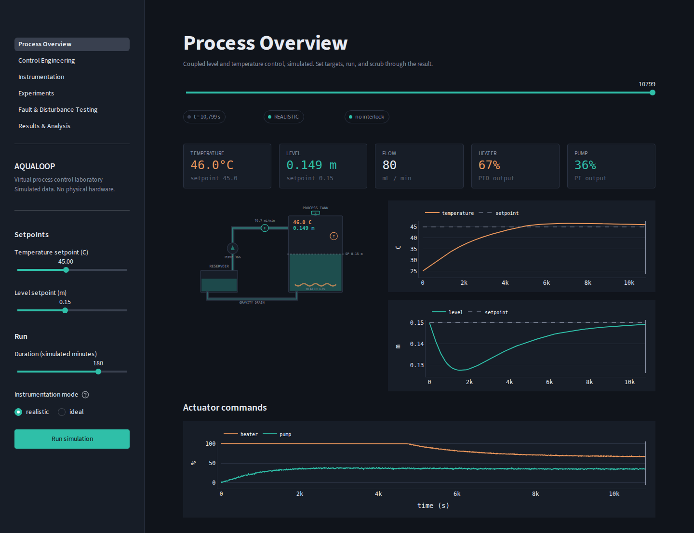
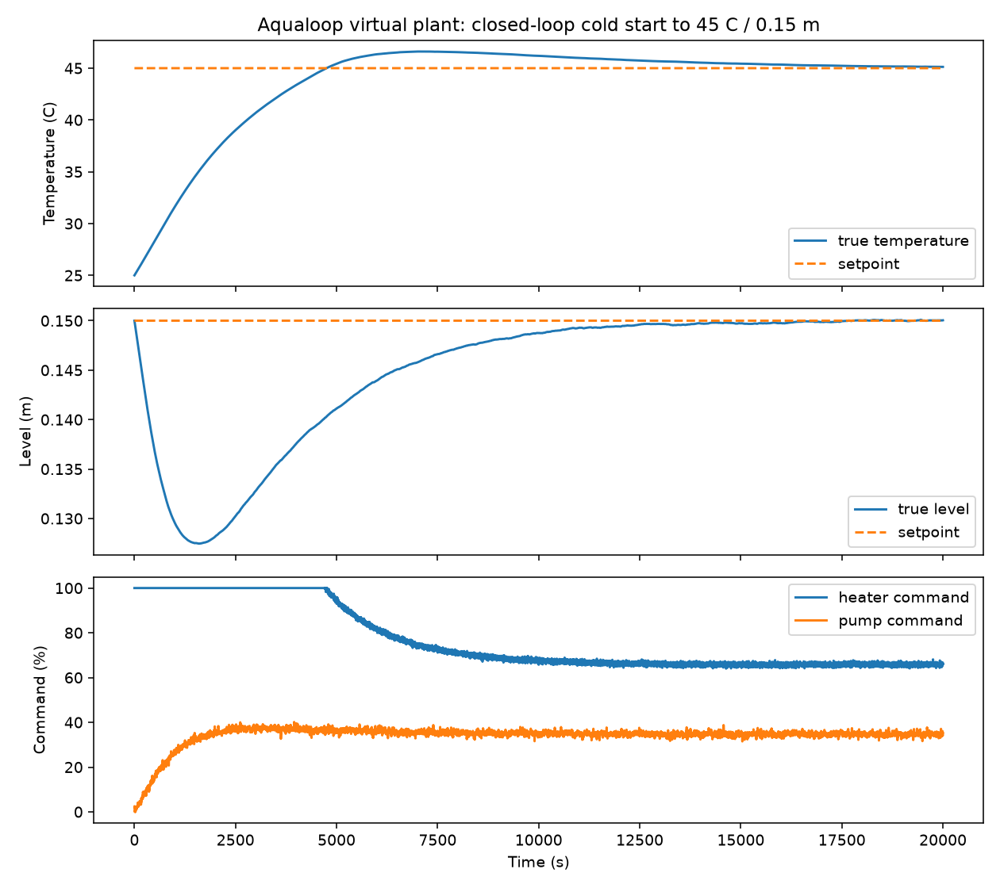
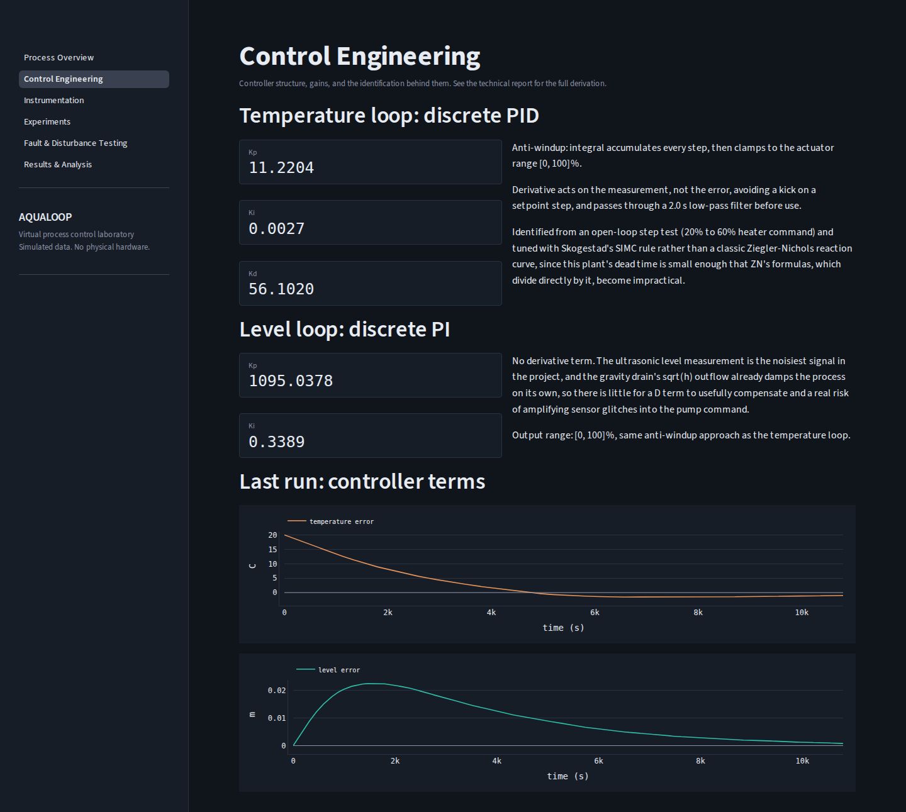
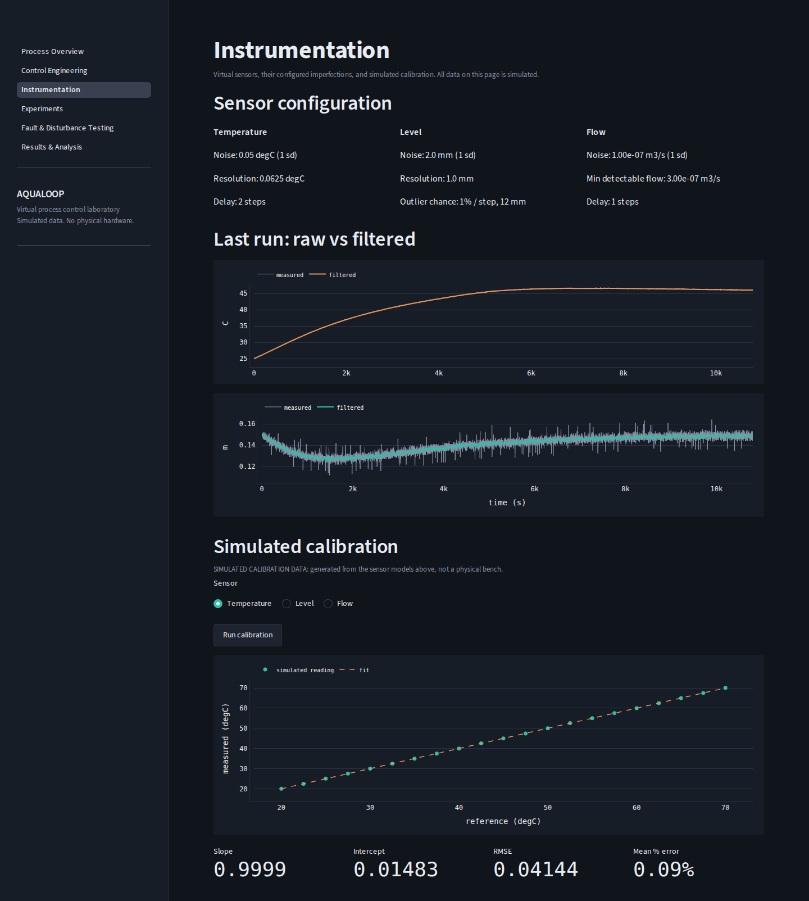
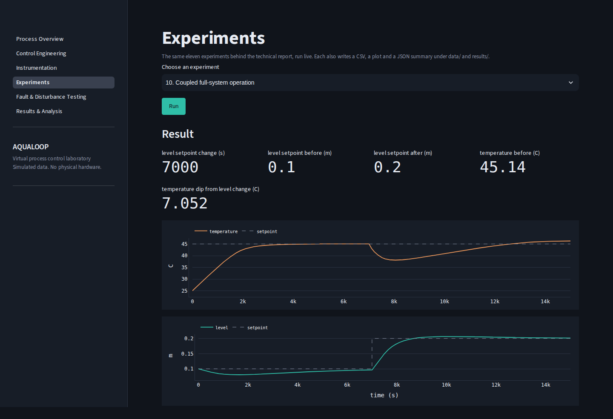
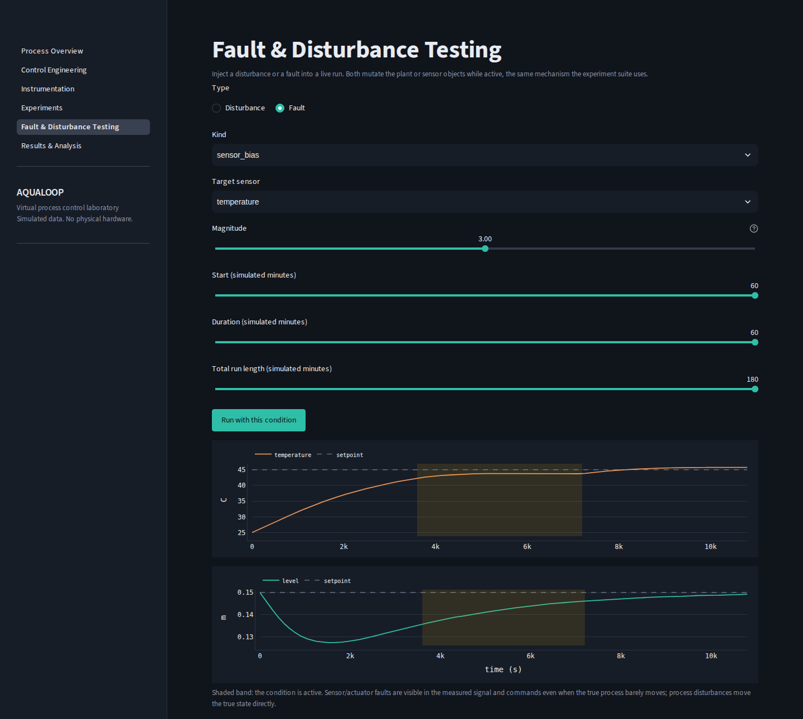
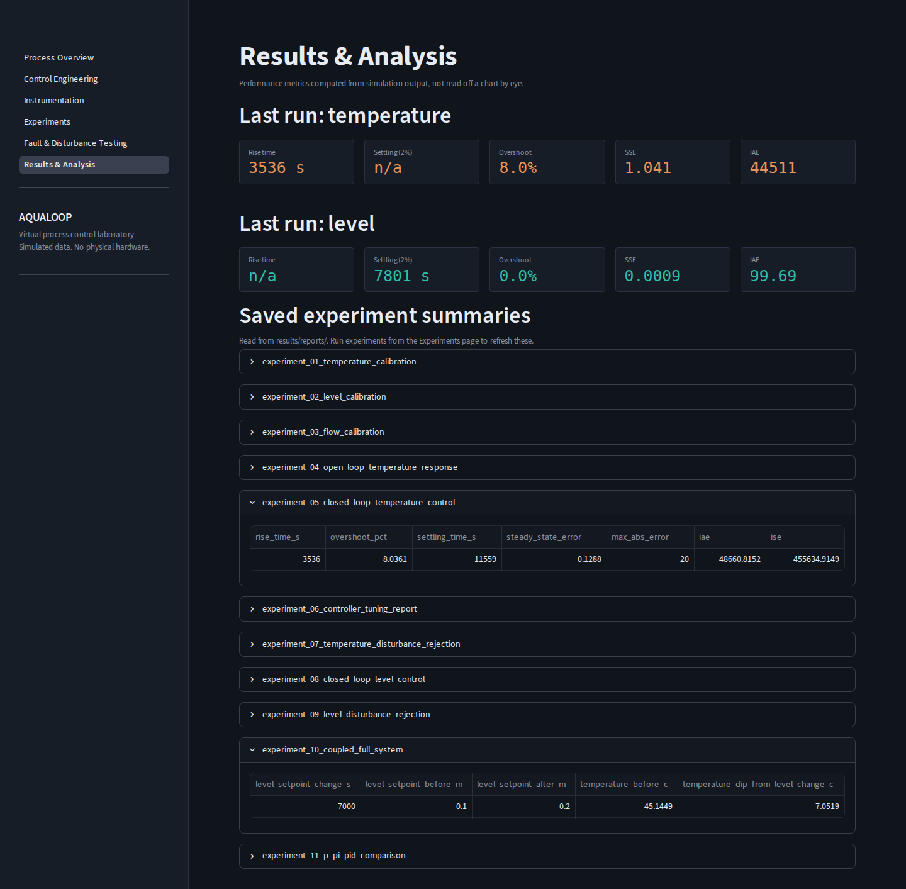

# Aqualoop

Virtual Multi-Loop Process Control and Instrumentation System

Aqualoop is a Python simulation of a small water process: a tank fed by a pump, drained by gravity, and warmed by an immersion heater. Two feedback loops run on it at the same time. A PI controller holds the water level, and a PID controller holds the water temperature. The loops interact, because the water the pump adds is cold. The repository contains the plant model, the controllers, virtual sensors with realistic imperfections, fault and disturbance injection, an experiment runner, a metrics module, and a Streamlit dashboard.

This is a software simulation. No hardware was built or connected. The physical parameters (tank size, heater power, pump curve, sensor noise) are stated assumptions in `src/simulation/configuration.py`, and every number in this README comes from simulated data, not from measurements on real equipment.



*Process Overview after a default run (45 °C, 0.15 m, 180 simulated minutes). The schematic, readouts and plots are all driven by the simulation.*

## Contents

- [Project overview](#project-overview)
- [Main features](#main-features)
- [Process model](#process-model)
- [Control system](#control-system)
- [Instrumentation, disturbances and faults](#instrumentation-disturbances-and-faults)
- [Experiments and results](#experiments-and-results)
- [Interactive dashboard](#interactive-dashboard)
- [Installation and setup](#installation-and-setup)
- [Project structure](#project-structure)
- [Testing and reproducibility](#testing-and-reproducibility)
- [Model assumptions and limitations](#model-assumptions-and-limitations)
- [Future work](#future-work)
- [Technical report](#technical-report)
- [License](#license)

## Project overview

The simulated rig has a 0.045 m² tank (about 21 cm by 21 cm, 0.30 m usable height) with a narrow gravity drain (1.2e-6 m² outlet), a pump that delivers up to 6e-6 m³/s (0.36 L/min), and a 180 W heater. Water arriving through the pump comes from a reservoir at 25 °C.

| Loop | Measured | Manipulated | Controller |
|---|---|---|---|
| Level | water level (m) | pump command (0 to 100 %) | PI |
| Temperature | water temperature (°C) | heater power (0 to 100 %) | PID |

The coupling is physical. To hold a level, the pump has to replace whatever leaves through the drain. At 0.15 m the drain passes about 77 mL/min, and that replacement water arrives 20 K colder than a 45 °C setpoint. A quick hand check: warming that flow costs about 5.3 W/K x 20 K = 106 W, plus about 12 W of loss to ambient, so roughly 118 W, or 66 % of the heater. The simulation settles at a heater command of about 66 %, which is consistent with that estimate. It also means a change in the level setpoint is a thermal disturbance for the temperature loop, which experiment 10 shows directly.

In the dashboard you can set both setpoints, run the coupled simulation and scrub through it, inspect the controller gains and sensor models, run any of the eleven experiments, inject a disturbance or fault into a live run, and read the computed performance metrics.

## Main features

- **Process simulation.** Level and temperature dynamics integrated with explicit Euler at a 1 s step, a nonlinear pump curve with a dead zone, and a heater dry-run interlock.
- **Control.** Hand-written discrete PI and PID controllers with output limits, integral clamping and derivative on measurement. Gains come from a step test plus SIMC tuning.
- **Instrumentation.** Virtual temperature, level and flow sensors with noise, quantization, delay, dropout and outliers, exponential moving average filters, and a linear calibration routine.
- **Disturbances and faults.** Three process disturbances and seven fault types that can be scheduled into any run.
- **Experiments.** Eleven scripted experiments. Each writes a JSON summary, and all but the tuning report also write a CSV and a plot.
- **Metrics.** Rise time, overshoot, settling time, steady-state error, IAE and ISE computed from simulation output.
- **Dashboard.** A six-page Streamlit app for running and inspecting all of the above.

## Process model

The tank level follows a mass balance with orifice drainage:

$$A\frac{dh}{dt} = Q_{\mathrm{in}} - Q_{\mathrm{out}}, \qquad Q_{\mathrm{out}} = C_d A_o \sqrt{2 g h}$$

The temperature follows an energy balance on a well-mixed tank whose mass changes as water flows in and out:

$$m c_p \frac{dT}{dt} = \rho Q_{\mathrm{in}} c_p \left(T_{\mathrm{in}} - T\right) + Q_{\mathrm{heater}} - Q_{\mathrm{loss}}, \qquad m = \rho A h, \quad Q_{\mathrm{loss}} = U\left(T - T_{\mathrm{amb}}\right)$$

| Symbol | Meaning | Value used |
|---|---|---|
| $A$ | tank cross-section | 0.045 m² |
| $C_d$, $A_o$ | discharge coefficient, outlet area | 0.62, 1.2e-6 m² |
| $Q_{\mathrm{in}}$ | pump flow | from the pump curve below |
| $T_{\mathrm{in}}$ | reservoir temperature | 25 °C |
| $\rho$, $c_p$ | water density, specific heat | 997 kg/m³, 4186 J/(kg K) |
| $Q_{\mathrm{heater}}$ | heater power | 180 W x command |
| $U$, $T_{\mathrm{amb}}$ | lumped loss coefficient, ambient | 0.6 W/K, 25 °C |

The outflow leaves at the tank temperature, so the $\rho Q_{\mathrm{out}} c_p T$ terms cancel when the balance is expanded, which is why only the inflow term appears. That inflow term is the coupling between the loops.

Other modelled effects:

- **Pump curve.** Below an 8 % command the pump moves no water. Above that, $Q_{\mathrm{in}} = Q_{\max}\left(\frac{u - 8}{92}\right)^{1.25}$, so flow builds more slowly than the command near the low end.
- **Changing thermal mass.** Because $m$ follows the level, a low tank heats quickly and a high tank slowly. The mass is floored at 0.05 kg to keep the equation well behaved.
- **Dry-run interlock.** If the level falls below 0.03 m the heater command is forced to zero regardless of the controller.

Assumptions: single well-mixed volume, lumped heat loss, constant fluid properties, and parameters chosen for a table-top rig rather than measured from one.

## Control system

| | Level loop | Temperature loop |
|---|---|---|
| Controller | PI | PID |
| Feedback signal | filtered level | filtered temperature |
| Output range | 0 to 100 % | 0 to 100 % |
| Anti-windup | integral clamped to the output range | integral clamped to the output range |
| Derivative | none | on measurement, 2 s low-pass filter |

Anti-windup here is a clamp on the accumulated integral term, not back-calculation. The derivative acts on the measurement so a setpoint step does not produce a kick in the heater command. The level loop has no D term because the ultrasonic level signal is the noisiest in the project and the drain's square-root outflow already damps the process.

**Tuning.** Each loop is identified from an open-loop step test (heater 20 % to 60 % for temperature, pump 20 % to 40 % for level) by fitting a first-order-plus-dead-time model. Gains then come from Skogestad's SIMC rule with a closed-loop time constant of one quarter of the process time constant. SIMC was used instead of the classic Ziegler-Nichols reaction-curve formulas because those divide directly by the dead time, which is small on this plant.

**Identified gains versus gains in use.** The two loops are not in the same state, and it is worth being explicit about it:

| | Kp | Ki | Kd |
|---|---|---|---|
| Level, identified by the current code | 1095.04 | 0.3389 | none |
| Level, in `configuration.py` | 1095.0378 | 0.3389 | none |
| Temperature, identified by the current code | 11.650 | 0.002877 | 58.25 |
| Temperature, in `configuration.py` | 11.2204 | 0.0027 | 56.102 |

The level gains match. The temperature gains in use come from an earlier identification run (about 0.325 °C per % and 4160 s) and are 4 to 6 % lower than what the current code identifies (0.316 °C per %, 4050 s, 87 s dead time). They were not regenerated, so the closed-loop results below use the "in use" gains. `results/reports/experiment_06_controller_tuning_report.json` records both sets.

## Instrumentation, disturbances and faults

**Virtual sensors** (defaults in `configuration.py`):

| Sensor | Noise (1 sd) | Resolution | Delay | Other |
|---|---|---|---|---|
| Temperature | 0.05 °C | 0.0625 °C | 2 steps | |
| Level | 2 mm | 1 mm | 1 step | 1 % chance per step of a 12 mm outlier |
| Flow | 1e-7 m³/s | none | 1 step | reads zero below 3e-7 m³/s |

The controllers see exponential moving average filtered versions of the temperature (alpha 0.3) and level (alpha 0.15) readings. The flow sensor is logged but not used for control. An "ideal" mode switches off noise, delay, quantization, dropout and the pump's dead zone, so the same plant and controllers can be compared with and without imperfect instrumentation.

**Calibration.** The calibration routine fits measured against reference values with a straight line and reports slope, intercept, RMSE and error. The default sensors are configured with a scale of 1 and a bias of 0, so the fitted lines come out close to y = x. What the calibration experiments actually show is the scatter from noise and quantization. The fitted correction is not applied inside the control loop.

**Process disturbances** change the plant: an ambient temperature step, an inflow (reservoir) temperature step, and an extra outflow such as a leak or manual draw-off.

**Faults** change a sensor or an actuator: sensor bias, noise multiplier, dropout and stuck reading (on any of the three sensors), reduced pump effectiveness, reduced heater effectiveness, and extra heat loss. The experiments use two of the disturbances (inflow temperature step and extra outflow). The dashboard exposes all of them.

## Experiments and results

All results below are simulated. Metric definitions follow `src/analysis/metrics.py`: rise time is 10 to 90 % of the step, settling time uses a band of 2 % of the setpoint that the response must stay inside until the end of the run, steady-state error is the mean absolute error over the last 200 samples, and overshoot is a percentage of the step size.

| # | Experiment | Key result |
|---|---|---|
| 1 | Temperature sensor calibration | slope 0.9999, intercept 0.015 °C, RMSE 0.041 °C (21 points, 20 to 70 °C) |
| 2 | Level sensor calibration | slope 0.9974, intercept 0.6 mm, RMSE 1.6 mm |
| 3 | Flow sensor calibration | slope 0.9967, RMSE 6.2e-8 m³/s, mean error 3.6 % |
| 4 | Open-loop temperature step | identified gain 0.316 °C per %, time constant 4050 s, dead time 87 s |
| 5 | Closed-loop temperature control | rise 3536 s, overshoot 8.0 %, settling 11,559 s, steady-state error 0.13 °C |
| 6 | Controller tuning report | identified and in-use gains, see [Control system](#control-system) |
| 7 | Temperature disturbance rejection | reported dip 5.1 °C, recovery 2220 s (read the note below) |
| 8 | Closed-loop level control | rise 1952 s, no overshoot, settling 3369 s, final error 1.9 mm |
| 9 | Level disturbance rejection | reported dip 45.7 mm, recovery 3356 s (read the note below) |
| 10 | Coupled full-system operation | 7.05 °C temperature dip after a level setpoint step |
| 11 | P, PI and PID comparison | P stalls 4.5 °C short, PI and PID nearly identical |

### Closed-loop cold start



This is the output of `scripts/run_demo.py` (and the same run as experiment 5). The heater is saturated at 100 % for the first 4764 s, the temperature overshoots to 46.6 °C at about 7000 s, then settles into the 2 % band (45 ± 0.9 °C) at 11,559 s. The heater ends near 66 % and the pump near 35 %. The script prints a steady-state error of 0.134 °C and experiment 5 reports 0.129 °C. The difference is only the averaging window (the last 500 s versus the last 200 s).

The level also deserves a look. It starts exactly at its setpoint, so the controller output starts at zero. The drain removes water, the level has to fall before the PI output builds up enough to match the drain, and it bottoms out at 0.1275 m at about 1590 s. The level is back at 0.150 m by the end of the run.

### Level control


The level starts at 0.08 m with a constant setpoint of 0.20 m. The pump is at 100 % for the first 385 s, then backs off as the level approaches the setpoint. There is no overshoot, and the level finishes about 2 mm below setpoint.

### Temperature disturbance rejection


The reservoir water runs 15 °C colder from 4000 s to 6000 s. **This experiment is not a clean disturbance test.** It starts with the temperature at setpoint but with the PID integral at zero, so the heater starts at 0 % and the temperature sags on its own. By 4000 s, before the disturbance begins, it is already at 41.5 °C, 3.5 °C below setpoint. The disturbance adds a further 1.6 °C, reaching 39.9 °C. The reported dip of 5.1 °C is the sum of both. The recovery time of 2220 s is measured from the end of the disturbance, and the final temperature is 45.0 °C.

Experiment 9 has the same structure for the level loop: the level is already 20 mm below setpoint at 1000 s when the draw-off starts, the draw-off adds 25 mm, and the reported 45.7 mm dip includes both.

### Coupled full-system operation


By 7000 s the temperature is at its 45 °C setpoint and the level is at 0.096 m against a 0.10 m setpoint. At 7000 s the level setpoint steps from 0.10 m to 0.20 m. The pump saturates for about 460 s to fill the tank, a lot of cold water enters, and the temperature falls from 45.2 °C to a minimum of 38.1 °C (a 7.05 °C dip against the 45.14 °C pre-step average). The heater then sits at 100 % from about 7200 s to 12,660 s.

The recovery is slow and the run ends before it settles. The temperature first re-enters the 2 % band about 4900 s after the step, then overshoots and finishes at 46.3 °C, still 1.3 °C above setpoint. The level reaches 0.20 m at about 8700 s, peaks at 0.2065 m, and ends at 0.2013 m.

### Controller comparison


| Controller | Rise time | Overshoot | Settling | Steady-state error | IAE |
|---|---|---|---|---|---|
| P | never reaches 90 % | 0 % | never | 4.54 °C | 113,872 |
| PI | 3536 s | 8.04 % | 11,555 s | 0.129 °C | 48,661 |
| PID | 3536 s | 8.04 % | 11,559 s | 0.129 °C | 48,661 |

The P-only controller settles near 40.5 °C and never reaches the setpoint. That residual offset is the textbook reason for adding integral action. PI and PID are almost indistinguishable here (the figure draws PI wide and PID thin so both are visible). The derivative term has very little effect on a plant with a time constant of about 4000 s, which is plausible but is the only explanation offered here, not something tested separately.

### Temperature sensor calibration


Slope 0.9999, intercept 0.015 °C, RMSE 0.041 °C over 21 points. As noted above, the default sensor has no configured bias or scale error, so this plot shows noise and quantization rather than a meaningful correction.

## Interactive dashboard

```bash
streamlit run app/dashboard.py
```

`.streamlit/config.toml` sets `headless = true`, so Streamlit does not open a browser by itself. Open http://localhost:8501 manually. The six pages are below. The screenshots were taken from the running app, and the fonts differ slightly from a normal install because the capture environment could not load the web fonts the theme requests.

### Process Overview

Set the temperature and level setpoints and the run length, choose realistic or ideal instrumentation, and run. The page shows the process schematic, live readouts, temperature and level plots, and the actuator commands, with a slider to scrub through the run. The first screenshot at the top of this README is this page.

### Control Engineering



The structure and gains of each controller, the reasoning behind the tuning, and the error signals from the last run.

### Instrumentation



Sensor settings, raw versus filtered signals from the last run, and an on-demand simulated calibration for any of the three sensors.

### Experiments



Run any of the eleven experiments live. Each run also rewrites that experiment's output files under `data/` and `results/`. The screenshot shows experiment 10.

### Fault and Disturbance Testing



Schedule a disturbance or fault into a live run. The screenshot shows a +3 °C bias on the temperature sensor from minute 60 to 120. The controller regulates the biased reading, so at minute 120 the true temperature is 43.7 °C while the filtered reading the controller sees is 46.7 °C. The true temperature only reaches the setpoint after the fault clears.

### Results and Analysis



Metrics for the last run, plus the saved JSON summary of every experiment. The metrics shown are for the default 180 minute run on the Overview page, which is shorter than the 20,000 s demo, so the temperature has not settled yet (settling shows as n/a) and the steady-state error is larger.

## Installation and setup

Python 3.10 or newer is required, because the minimum Streamlit version (1.56) needs it. Everything in this README was run on Python 3.12.3 on Linux. The Windows commands below are the standard equivalents and were not run.

Linux or macOS:

```bash
git clone <your-repo-url> aqualoop
cd aqualoop
python3 -m venv .venv
source .venv/bin/activate
python -m pip install -r requirements.txt
```

Windows PowerShell:

```powershell
git clone <your-repo-url> aqualoop
cd aqualoop
py -m venv .venv
.venv\Scripts\Activate.ps1
python -m pip install -r requirements.txt
```

Then, from the project root:

```bash
python -m pytest tests/ -q            # run the test suite
python scripts/run_demo.py            # cold-start demo, prints metrics, writes a plot
python -m src.experiments.runner      # run all 11 experiments
streamlit run app/dashboard.py        # launch the dashboard
```

`requirements.txt` sets lower bounds only. A fresh install resolves to current releases. The experiment outputs are generated locally, so nothing needs to be downloaded.

## Project structure

```text
aqualoop/
├── app/                    Streamlit dashboard
│   ├── dashboard.py        entry point and navigation
│   ├── views/              the six pages
│   ├── schematic.py        process diagram
│   ├── sim_state.py        session state
│   └── theme.py            colours, fonts, plot styling
├── src/
│   ├── plant/              tank, thermal model, coupled process and interlock
│   ├── control/            PI, PID, and step-test tuning (SIMC)
│   ├── instrumentation/    sensors, filtering, calibration
│   ├── simulation/         configuration, engine, disturbances, faults
│   ├── analysis/           performance metrics
│   └── experiments/        the 11 experiments, runner, output saving
├── scripts/run_demo.py     cold-start demonstration
├── tests/                  pytest suite
├── docs/
│   ├── Aqualoop_Technical_Report.docx
│   ├── images/             screenshots and plots used in this README
│   └── report_build/       scripts and figure copies used to build the report
├── data/generated/         experiment CSVs (generated, git-ignored)
├── results/figures/        experiment plots (generated, git-ignored)
├── results/reports/        experiment JSON summaries (generated, git-ignored)
├── .streamlit/config.toml  theme and server settings
└── requirements.txt
```

## Testing and reproducibility

```bash
python -m pytest tests/ -q
```

The suite has 64 tests covering the tank and thermal physics, the coupled process, controllers, sensors and calibration, disturbances and faults, the simulation engine, the metrics, and a smoke test that loads each dashboard page. All 64 passed on Python 3.12.3 with NumPy 2.5, pandas 3.0, SciPy 1.18, Matplotlib 3.11, Plotly 7.1, Streamlit 1.66 and pytest 9.1. The tests also pass on NumPy 1.26 when paired with a pyarrow release that supports it.

Experiments write to `data/generated/` (CSV), `results/figures/` (PNG) and `results/reports/` (JSON). Those folders are git-ignored because they are regenerated by `python -m src.experiments.runner`. The images in `docs/images/` are copies of selected outputs and dashboard screenshots so they display on GitHub.

The random seed is fixed (`SimulationConfig.random_seed = 42`) and the sensor noise comes from a seeded generator. Re-running all eleven experiments on the machine used for verification reproduced the previously stored CSV files exactly and the JSON summaries to floating-point precision.

## Model assumptions and limitations

- **No hardware validation.** All parameters are assumptions for a table-top rig. Results describe this model and do not say how a real plant would behave.
- **Simplified physics.** One well-mixed volume, lumped heat loss, constant fluid properties, explicit Euler at 1 s.
- **Approximate identification.** The open-loop temperature test is still rising when its 18,000 s record ends, so the identified gain and time constant are approximations. The temperature controller gains in use differ from the current identification by 4 to 6 % (see [Control system](#control-system)).
- **Calibration.** Default sensors have no bias or scale error, and the fitted correction is not applied in the loop.
- **Experiments 7 and 9** start with the controller integrators at zero rather than at their steady operating values, so the reported dips include start-up sag (see [Experiments and results](#experiments-and-results)).
- **Experiment 10** ends before the temperature settles after the level change.
- **Cold-start level sag.** The level dips below its setpoint at the start of every run for the same integrator reason.
- **Dashboard run length.** The default 180 minute run is shorter than the time the temperature loop needs to settle.
- **Server settings.** `.streamlit/config.toml` also disables CORS and XSRF protection, which is fine for local use but should be reviewed before deploying the dashboard anywhere public.

This is an engineering simulation and analysis tool. It is not a validated industrial control product.

## Future work

- Initialise the controllers at their steady operating values in experiments 7 and 9 so the disturbance metrics measure only the disturbance.
- Regenerate the temperature gains from the current identification, or run the step test to steady state first.
- Extend experiment 10 so the temperature has time to settle after the level change.
- Apply the fitted calibration correction inside the control loop and compare the result.
- Hardware-in-the-loop work, if a physical rig is ever built. Nothing like that exists in this repository.

## Technical report

[`docs/Aqualoop_Technical_Report.docx`](docs/Aqualoop_Technical_Report.docx) is the longer write-up. It covers the derivation of the level and thermal models, the coupling between the loops, the sensor models and calibration, controller design and tuning, the disturbances and faults, results for each experiment, and the report's own limitations and future-work sections. One caution: its tuning table lists the current identified model next to the gains in use, which differ slightly (see [Control system](#control-system)). It has not been rebuilt.

## License

This repository does not include a license file.
